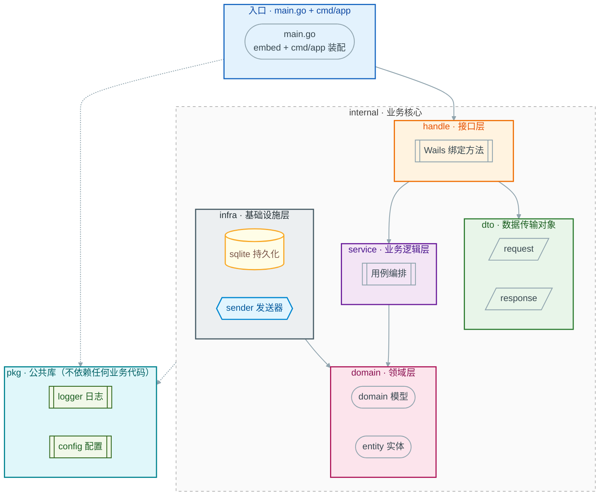
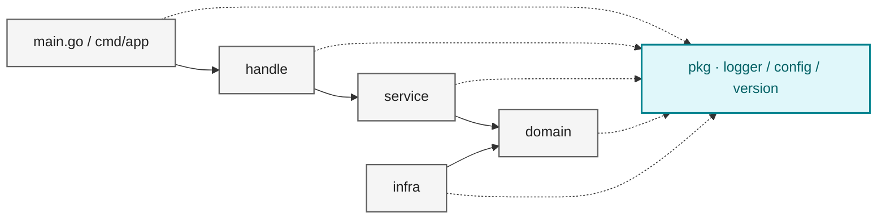

# 项目架构

## 分层结构

## 各层职责

| 层级 | 目录 | 职责 |
| --- | --- | --- |
| 入口层 | 根 `main.go` + `cmd/app/` | `main.go` 只做 embed；`cmd/app` 负责数据目录、配置、依赖注入与 `wails.Run` |
| 接口层 | `internal/handle/` | Wails 绑定方法：参数校验、错误翻译、DTO 转换、事件发送 |
| 传输层 | `internal/dto/` | Wails 方法的入参/出参结构，不放领域实体 |
| 业务层 | `internal/service/` | 编排领域逻辑，实现业务用例 |
| 领域层 | `internal/domain/` | 领域模型、实体与端口接口，核心业务规则 |
| 基础设施层 | `internal/infra/` | sqlite、sender、平台适配器、DPAPI、updater（GitHub 版本查询）等外部依赖 |
| 公共层 | `pkg/` | 与业务无关的通用库：`logger` 日志、`config` 配置与数据目录 |

没有本地 HTTP 服务：前端通过 Wails 绑定调用 Go，Go 只发出站 HTTPS。

## 依赖方向

> **依赖倒置原则**：上层依赖下层抽象，`domain` 处于最内层，不依赖任何外层；`infra` 实现 `domain` 定义的接口，通过依赖注入在 `cmd` 中完成装配。
> **`pkg` 的约束**：
>
> - **可以被任意层引用**（`cmd` / `handle` / `dto` / `service` / `domain` / `infra` 均可 import）—— 箭头方向是**各层 → `pkg`**
> - **自身禁止反向依赖**：`pkg` 不得 import `internal/` 下任何包，也不得引用 `cmd/`
> - 只放**与业务无关**的能力。当前三个子包：
>   - `pkg/logger` —— 结构化日志、级别控制、滚动输出、凭据打码
>   - `pkg/config` —— 配置文件解析、数据目录解析与默认值
>   - `pkg/version` —— 版本号规范化与 semver 比较
> - 后续新增子包须满足同样约束；一旦掺入业务语义，就应下沉到 `domain` 或上移到 `service`
> - 各 `pkg` 子包之间尽量**互不依赖**（如 `config` 可选用 `logger` 输出加载信息，但应保持单向、可省）
